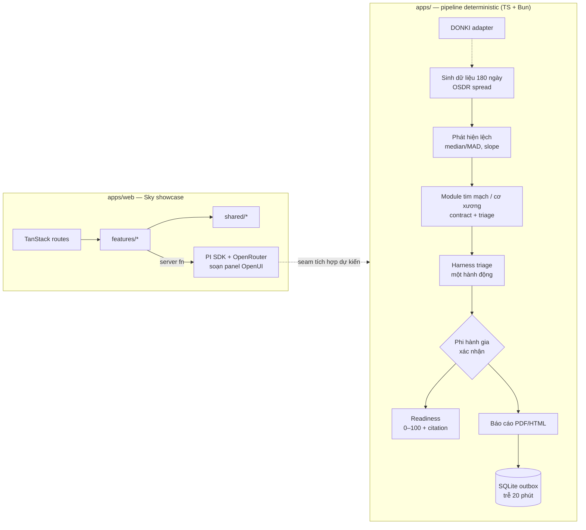

# Kiến trúc — HKT / Sky

Tài liệu này mô tả **cấu trúc code đang có** trong repo, luồng dữ liệu, ranh giới layer và các
ràng buộc kiến trúc. Hợp đồng sản phẩm (phạm vi, luật hackathon, checklist nộp bài) nằm ở root
`AGENTS.md`; tổng quan sản phẩm và tech stack nằm ở `README.md`. Khi code đổi cấu trúc, cập nhật file này.

---

## 1. Sản phẩm trong một đoạn

**HKT** là bài dự thi NASA Space Apps 2026: phần mềm theo dõi sức khỏe phi hành gia chạy **offline**
trên một laptop. Hệ thống lấy baseline riêng của từng người, phát hiện lệch bằng luật deterministic,
chỉ liều tập / hành động an toàn, để phi hành gia **xác nhận**, rồi gửi báo cáo về Trái Đất qua link
trễ 20 phút. Điểm 0–100 “Mars landing readiness” có công thức minh blanco, mỗi trọng số có nguồn.

Repo chứa hai sản phẩm phần mềm tách biệt:

| Thành phần | Vai trò | Trạng thái |
|---|---|---|
| `apps/web` | Web app **Sky**: console + trang concept/demo/story, dựng panel bằng OpenUI | Đang chạy |
| `apps/` | Pipeline sức khỏe TypeScript (Bun): sinh dữ liệu → phát hiện lệch → readiness → draft → confirm → báo cáo | Đang chạy (CLI + test) |
| `apps/onboard` | App phi hành gia (NiceGUI), dự kiến | Chưa có code (chỉ `.gitkeep`) |

`practice/` là monorepo luyện tay riêng, **không** thuộc bài nộp và không chia sẻ code với
`apps/`.

---

## 2. Bản đồ repository

```text
nsac/
├── apps/
│   ├── web/                 Sky (TanStack Start + React 19 + Nitro, bun)
│   ├── onboard/             (dự kiến) NiceGUI — chưa có code
│   ├── generative-ui/       (chỗ giữ) catalog/renderer/presets — chưa dùng
│   └── website/             (chỗ giữ) — chưa dùng
├── apps/                     TypeScript package `nsac` (bun)
│   └── src/nsac/
├── tests/                   bun test, phản chiếu apps/
├── docs/references/         Catalog chỉ số, ghi chú đề bài, NASA-STD-3001 tách mục
├── assets/                  fixtures/, models3d/ (kèm license/nguồn)
├── scripts/                 (chỗ giữ)
├── var/                     Trạng thái runtime, gitignored
├── STORY.md                 Nguồn duy nhất của truyện "Sky"
└── ARCHITECTURE.md          File này
```

Workspace JS ở root: `package.json` (bun, `workspaces: ["apps/*"]`), `turbo.json`, `tsconfig.base.json`.
Chỉ `apps/web` hiện là package JS (`@nsac/web`). App TS và `practice/` nằm ngoài workspace.

---

## 3. Kiến trúc tổng thể



Hai phần hiện **chưa nối trực tiếp**: web app dùng một scenario minh họa trong
`features/readiness-demo/api/scenario.server.ts`, còn backend chạy qua `MissionPipeline`.
Điểm nối dự kiến là server function của web gọi API TS (hoặc thay scenario bằng dữ liệu thật).

---

## 4. Backend TS — pipeline sức khỏe

### 4.1 Luồng dữ liệu

```text
Reading[] (baseline)  ─┐
Reading[] (current)   ─┴─► detect() ──► Deviation[] ──► recommend() ──► Recommendation?
                                                                           │
                                                      phi hành gia confirm │
                                                                           ▼
                                                                     ActionTaken
                                                                           │
Deviation[] + ActionTaken[] + ReadinessScore ──► GroundReport ──► Outbox (deliver_at = +20 phút)
```

Các bước được điều phối bởi `MissionPipeline` (`apps/src/nsac/api/pipeline.ts`):

| Method | Việc làm |
|---|---|
| `evaluate(baseline, current)` | `domain.health.detect` → `Deviation[]` |
| `score(cardio, musculoskeletal, exercise_adherence)` | `domain.health.readiness` → `ReadinessScore` |
| `draft()` | `AgentSession.draft` → `Recommendation \| None` |
| `confirm()` / `reject()` | Chốt hoặc bỏ hành động đang chờ |
| `report(summary)` | Ghép `GroundReport` với `deliver_at` |
| `queue(report, outbox)` | Ghi SQLite outbox |

### 4.2 Layer và chiều phụ thuộc

```text
api/  ──►  harness/ | agent/ | modules/  ──►  domain/  ──►  contracts/
              ▲                                  ▲
              └────────── adapters/ ─────────────┘   (cài đặt interface, IO)
```

- `contracts/` — schema TypeScript (zod) dùng chung (`Reading`, `Deviation`, `Recommendation`,
  `ReadinessScore`, `GroundReport`, …), không IO, không import layer khác.
- `domain/` — entity + luật thuần: `detection.ts` (modified z-score, MAD, slope, phân loại
  green/yellow/red), `readiness.ts` (trọng số + citation).
- `modules/` — contract `HealthModule` (interface) cho module cắm được: `cardio`,
  `musculoskeletal`, `space_weather`, `epidemic`, `stubs`. Hiện chủ yếu là `.gitkeep` + contract.
- `harness/` — điều phối deterministic: `triage/policy.ts` chọn **một** hành động theo thứ tự
  red → gần hạ cánh → cơ xương → giấc ngủ.
- `agent/` — `AgentSession` (class) giữ hành động đang chờ và cổng confirm; `rag/` mới là chỗ giữ.
- `reporting/` — template HTML/PDF (Bun), template trong `templates/`.
- `adapters/` — IO cụ thể: `sqlite/outbox.ts` (hàng đợi trễ), `donki/flares.ts` (space weather,
  trả rỗng khi offline), `ollama/narrate.ts` (diễn giải tuỳ chọn), `osdr/crew.ts` (stub).
- `simulation/` — generator 180 ngày theo spread OSDR, inject kịch bản, chuyển `Trajectory` →
  `Reading`.
- `api/` — lớp mỏng cho UI (`MissionPipeline`), không chứa UI concern.
- `demo.ts` — CLI smoke test chạy toàn bộ pipeline có bước `[Confirm]`.

### 4.3 Bất biến quan trọng

- **AI không quyết định**: `detect` và `recommend` thuần deterministic; LLM chỉ viết lại
  `rationale`, không đổi action/dose/checklist.
- **Không áp dụng gì trước confirm**: `AgentSession.confirm()` trả `null` khi chưa có draft hoặc
  draft đã confirm; `report` chỉ ghi `actions_taken` đã confirm.
- **Mọi ngưỡng/trọng số có nguồn**: `Deviation.threshold_source_url`, `ScoreComponent.source_url`,
  `Recommendation.checklist_ref` là field bắt buộc.
- **Trọng số readiness cộng đúng 1.0**: validator ở `ReadinessScore`; hiện là
  cardio 0.40, musculoskeletal 0.40, exercise_adherence 0.20 (NASA-STD-3001 Vol 1 Rev B).
- **Không có model orthostatic 3/8 G**: score là công thức minh họa có citation, không phải model y khoa.
- **Link trễ 20 phút**: `Outbox.deliver_at_after` cộng `DELAY_MINUTES = 20`.

### 4.4 Trạng thái thật so với kế hoạch

| Hạng mục | Hiện tại |
|---|---|
| Generator + detection + readiness + triage + outbox + report | Đã có, có test |
| Agent LangGraph, SQLite checkpointer, `interrupt()` | Chưa; thay bằng `AgentSession` class |
| RAG ISS Medical Checklist / NASA docs (Docling + Chroma) | Chưa; `agent/rag/` là chỗ giữ |
| OSDR pull thật (httpx) | Stub trả `[]` |
| NiceGUI (`apps/onboard`) | Chưa có code |
| Modules tim/cơ/xương | Chỉ contract; logic nằm trong domain + triage |

---

## 5. Web app `apps/web` — Sky

### 5.1 Stack và runtime

- TanStack Start (Vite) + TanStack Router file routes + React 19 + Nitro + zod.
- OpenUI `@openuidev/react-lang` (pinned 1.1.0) dựng panel; PI SDK
  `@earendil-works/pi-coding-agent` (pinned 1.5.2) chạy server-side để soạn panel.
- Bun là package manager; build ra `.output/`, chạy production bằng
  `PORT=3100 bun .output/server/index.mjs`.
- `nitro({ preset })` trong `vite.config.ts` là chỗ duy nhất chọn runtime: mặc định `bun`,
  `NITRO_PRESET=node-server` cho Node.

### 5.2 Layout layer

```text
src/routes/           file-based, mỏng: khai báo ssr mode, loader, search params
      │
src/features/<name>/  một feature = components/ + model/ + api/ + index.ts (public surface)
      │
src/shared/           i18n, layout, ui, sky ids, sources — KHÔNG import features
```

- Feature chỉ export qua `index.ts`; route lắp ghép feature.
- `model/` thuần, không React/IO để vitest cover.
- `src/routeTree.gen.ts` sinh tự động và gitignored.

### 5.3 Routes và SSR mode

| Route | SSR | Nội dung |
|---|---|---|
| `/` | `true` | Console của Sky, đúng một ảnh (Sky), panel dựng bằng OpenUI |
| `/concept` | `true` | Hero, core features, hazards, data, pipeline, demo/story teaser, modules, trust, earth, sources |
| `/demo` | `'data-only'` | Demo readiness tương tác: alert → Confirm → Fast-forward |
| `/story` | `true` | Đọc `STORY.md` |

Search params được validate bằng zod và **lenient** (`.catch(undefined)`): `?lang=en|vi` ở root,
`?stage=` ở `/demo`. Giá trị sai rơi về mặc định, không hiện trang lỗi.

### 5.4 Ranh giới server

- File `*.server.ts` mở đầu bằng `import "@tanstack/react-start/server-only"` và chỉ được import
  bởi `*.functions.ts` tương ứng.
- `*.functions.ts` khai báo `createServerFn`; route/component chỉ gọi các export này.
- Không đọc `process.env` hoặc filesystem ngoài `*.server.ts`.
- Ví dụ seam dữ liệu: `readiness-demo/api/scenario.server.ts` là nơi thay bằng adapter thật;
  phần còn lại của web chỉ thấy `ScenarioParams` / `Snapshot`.

### 5.5 Sky guide và OpenUI

```text
SkyGuideProvider (root layout)
  └── SkyStation id=...            đặt trên route
        └── PanelScopeProvider     giới hạn fact + heading level
              └── OpenUI Renderer  preset ngay, rồi panel do model soạn
```

- Station ids ở `shared/sky.ts` (`console`, `welcome`, `hazards`, `data`, `pipeline`, `readiness`,
  `story`); mỗi station có preset OpenUI Lang trong `shared/i18n`.
- `catalog/library.tsx`: catalog model-facing (`Console`, `Card`, `Say`, `Fact`, `Badge`, `Alert`,
  `Steps`, `GoTo`) bọc component Arc (uiarc.dev, MIT) vendored trong `src/components/arc/`.
- **Không action đổi trạng thái** trong catalog; số chỉ vào panel qua `Fact(id)`.
- `model/program.ts` review panel: parse sạch, không chữ số trong free text, fact nằm trong
  allowlist của station, giới hạn `MAX_PROGRAM_CHARS = 2400`. Vi phạm → giữ preset.
- API key OpenRouter: env `SKY_OPENROUTER_API_KEY` trước, rồi `var/sky-openrouter.json`
  (0600, gitignored); chỉ có đường ghi, không có đường đọc ra client. Thiếu key / mất mạng →
  preset vẫn render.

### 5.6 Nội dung, i18n, nguồn

- Toàn bộ text UI ở `shared/i18n/{en,vi}.ts` trên một type `Copy`, nên hai ngôn ngữ không lệch.
- `shared/sources.ts` là danh sách nguồn duy nhất cho mọi claim ra ngoài; `checked` chỉ ghi khi
  người thật đã mở URL.
- Ngưỡng y khoa chỉ hiển thị khi truy vết được về NASA-STD-3001 Vol 1 Rev B.
- `docs/references/nasa-std-3001/` chứa bản tách mục của chuẩn (Docling), dùng để đối chiếu `[V1 xxxx]`.

---

## 6. Dữ liệu và provenance

| Nguồn | Dùng ở đâu |
|---|---|
| OSDR OSD-569 / OSD-575 | Spread cho generator; ghi chú adapter |
| OSDR API | Kế hoạch pull thật |
| DONKI | `adapters/donki` — penalty giấc ngủ sau bão Mặt Trời |
| ISS Medical Checklist (mirror) | `checklist_ref` của Recommendation |
| Circulation 2026 (tim ISS 2 tuần) | Spread `lv_volume` / `stroke_volume` |
| NASA-STD-3001 Vol 1 Rev B | Trọng số readiness, fact panel Sky, ngưỡng hiển thị |
| NASA Five Hazards, Mars fact sheet | Nội dung concept, fact panel |

Mọi URL phải kèm ngày kiểm tra khi con người đã mở; không đưa key/token vào repo.

---

## 7. Build, chạy, kiểm tra

### Web

```bash
bun install                    # từ root
bun run dev                    # turbo run dev → apps/web :3000
bun run typecheck
bun run test
bun run build
cd apps/web && PORT=3100 bun run .output/server/index.mjs
```

Nix: `nix build .#web` / `nix run .#web` (port 3100) và `nix build .#backend` / `nix run .#backend`
(backend API, port 3200 mặc định — `PORT`, `SKY_DB_PATH` override được; bind `127.0.0.1` mặc định,
`HOST` override được). Cả hai package dùng chung một fixed-output derivation node_modules; `outputHash`
phải bump khi `bun.lock` đổi.

### Backend (TS + Bun)

`apps/backend` — HTTP API (astronauts + claims, SQLite qua drizzle), chạy bằng Bun trực tiếp từ TypeScript:

```bash
cd apps/backend
bun install
bun test                         # 12 tests
PORT=3200 bun run src/server.ts  # bind 127.0.0.1 mặc định (HOST override)
```

Nix: `nix build .#backend` / `nix run .#backend` (port 3200, `SKY_DB_PATH` mặc định
`/home/ec2-user/nsac/var/sky.db`, GC-root/deploy do box quyết định).

### Kiểm tra kiến trúc khi thêm code

- Layer mới ở backend phải theo chiều `api → harness/agent/modules → domain → contracts`; adapter
  cài đặt interface, không bị domain import ngược.
- Feature web mới: `routes/` mỏng, UI trong `features/<name>/`, export qua `index.ts`, text vào cả
  `en` và `vi`, nêu SSR mode và lý do, đặt ít nhất một `<SkyStation>`.
- Component OpenUI mới: vendor Arc → wrap `defineComponent` → đăng ký `skyLibrary` → test trong
  `catalog/library.test.ts`.
- Đừng đưa secret, số liệu y khoa không nguồn, hay ảnh trẻ vị thành niên vào repo/UI.

---

## 8. Khoảng trống đã biết

- Chưa có model mở cho orthostatic tolerance ở 3/8 G; readiness là công thức minh họa.
- Không có ECG/echo liên tục công khai; tín hiệu tim là synthetic theo paper.
- Web↔backend hiện chỉ nối ở picker `/` (roster từ backend với fixture fallback, pick claim-locked qua `/api/claims`); `/demo` vẫn dùng scenario minh họa, không phải dữ liệu pipeline.
- `apps/onboard`, `apps/generative-ui`, `apps/website`, `scripts/`, `assets/fixtures/` mới là chỗ giữ.
- RAG, LangGraph, checkpointer, PDF trên máy demo (WeasyPrint/Pango) chưa hoàn tất.
- Panel Sky cần mạng + key OpenRouter để soạn; offline chỉ giữ preset (đúng thiết kế).

---

## 9. Bản đồ tài liệu

| File | Nội dung |
|---|---|
| `AGENTS.md` | Hợp đồng DOX, luật HKT, phân chia việc, checklist nộp |
| `apps/web/AGENTS.md` | Hợp đồng riêng của web app Sky |
| `practice/AGENTS.md` | Hợp đồng monorepo luyện tay (ngoài bài nộp) |
| `docs/references/AGENTS.md` | Hợp đồng catalog tham chiếu |
| `README.md` | Tổng quan sản phẩm, demo 60 giây, tech stack |
| `STORY.md` | Truyện "Sky" (nguồn duy nhất) |
| `ARCHITECTURE.md` | File này: cấu trúc code và luồng dữ liệu |